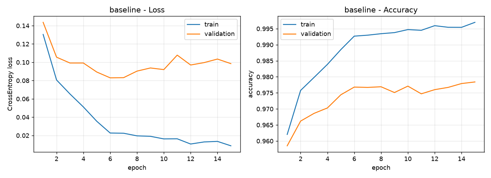
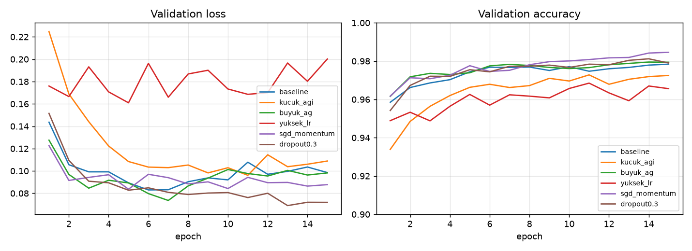
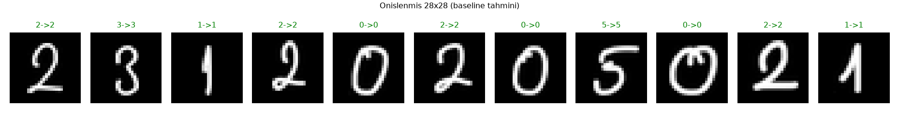

# MNIST ile MLP Tabanlı El Yazısı Rakam Tanıma

Ders ödevi: MNIST üzerinde **sıfırdan** eğitilmiş bir MLP (CNN yok, hazır model yok) ve kendi el yazımla yazdığım okul numarası (`23120205021`) üzerinde test.

## Çalıştırma
```bash
python -m venv .venv && source .venv/bin/activate
pip install torch torchvision matplotlib numpy pillow
python mnist_mlp.py                                   # eğitim + deneyler -> outputs/
python predict_digits.py my_digits/numara.jpg --label 23120205021
```

## Veri ve bölme
| Küme | Boyut | Kullanım |
|---|---|---|
| Train | 50000 | ağırlık güncelleme |
| Validation | 10000 | hiperparametre/model seçimi |
| Test | 10000 | **sadece en sonda**, baseline + validation'ın seçtiği model için bir kez |

MNIST'in 60k eğitim seti, sabit seed (42) ile 50k/10k bölündü; 10k test seti hiçbir seçimde kullanılmadı. Girdi 28×28 → 784'e düzleştirildi, `(x/255 - 0.1307) / 0.3081` ile normalize edildi.

## Deney 1 – Temel MLP
784 → 256 → ReLU → 128 → ReLU → 10, CrossEntropyLoss (softmax dahil), Adam (lr=1e-3), batch 128, 15 epoch, seed 42, CPU.

| Metrik | Değer |
|---|---|
| Training loss | 0.0087 |
| Validation loss | 0.0985 |
| Training accuracy | %99.70 |
| Validation accuracy | %97.84 |
| **Test accuracy** | **%97.92** |
| Eğitim süresi | 3.5 sn |

Eğitim eğrileri: 

## Hiperparametre karşılaştırması
Hepsi aynı seed, aynı bölme, 15 epoch, batch 128. Metrikler son epoch'tan. Test accuracy yalnızca baseline ve validation'a göre seçilen en iyi model için hesaplandı.

| config | hidden | optimizer | lr | momentum | dropout | train loss | val loss | train acc % | val acc % | test acc % | süre (sn) |
|---|---|---|---|---|---|---|---|---|---|---|---|
| baseline | 256-128 | adam | 0.001 | - | - | 0.0087 | 0.0985 | 99.70 | 97.84 | 97.92 | 3.5 |
| kucuk_agi | 64-32 | adam | 0.001 | - | - | 0.0246 | 0.1089 | 99.20 | 97.25 | - | 2.7 |
| buyuk_ag | 512-256-128 | adam | 0.001 | - | - | 0.0094 | 0.0982 | 99.68 | 97.94 | - | 7.9 |
| yuksek_lr | 256-128 | adam | 0.01 | - | - | 0.0757 | 0.2002 | 98.11 | 96.56 | - | 4.2 |
| sgd_momentum | 256-128 | sgd | 0.05 | 0.9 | - | 0.0002 | 0.0877 | 100.00 | 98.46 | 98.26 | 2.6 |
| dropout0.3 | 256-128 | adam | 0.001 | - | 0.3 | 0.0144 | 0.0719 | 99.56 | 97.90 | - | 4.2 |



**En iyi (validation'a göre): `sgd_momentum`.**

### Yorum
- **Ağ kapasitesi:** 64-32 ağı (val %97.25) baseline'dan (%97.84) belirgin kötü; kapasite yetersiz. 512-256-128 (%97.94) neredeyse aynı, yani kapasiteyi artırmak 2× süreye rağmen neredeyse hiç kazandırmadı.
- **Learning rate:** Adam'da 1e-2 hem loss'u hem accuracy'yi bozdu (val loss 0.20); adımlar çok büyük, minimumun etrafında zıplıyor.
- **Optimizer:** SGD+momentum (lr 0.05) en iyi validation accuracy'yi verdi. Ancak train accuracy %100 ve train loss ≈ 0; model train setini ezberlemiş, genelleme farkı (~%1.5) baseline'dan küçük değil.
- **Dropout:** val loss'u en düşük yapan config (0.072). Train-val farkını daralttı ama accuracy'de anlamlı bir kazanç yok.
- **Overfitting:** Tüm configlerde train acc > val acc ve val loss, train loss'tan çok yüksek; 15 epoch'ta MLP train setini neredeyse ezberliyor. Tek seed ile çalıştığım için configler arasındaki ~%0.1'lik farklar gürültü sınırında; yalnızca büyük farklar (64-32 ağı, lr=1e-2) güvenilir.

## Kendi el yazım
iPad'de Apple Pencil ile, beyaz zemin üzerine siyah kalemle okul numaramı yazdım: `my_digits/numara.jpg` (`23120205021`).

Önişleme (`predict_digits.py`): gri tonlama → zemin açık olduğu için renk tersleme (MNIST: siyah zemin, beyaz rakam) → rakamları ayırma → her rakamı en-boy oranı korunarak 20×20'ye sığdırma → ağırlık merkezine göre 28×28'in ortasına yerleştirme → MNIST ile aynı normalizasyon. Önişlenmiş rakamlar: `outputs/preprocessed_numara.png`.



**Sonuç: baseline 11/11, en iyi model (SGD+momentum) 11/11 doğru.** En düşük güven: baseline'da ilk rakam `2` (0.91) ve son rakam `1` (0.86).

**Dürüstlük notu:** `2-0`, `0-2`, `0-2-1` rakamları birbirine değdiği için otomatik ayırma önce yalnızca 8 parça buldu. Parçaları, beklenen rakam sayısını (11, `--label` uzunluğu) kullanarak en az mürekkep olan noktadan böldüm. Yani ayırma adımı etiketin *uzunluğunu* biliyor (rakam değerlerini değil); model tahmini bundan bağımsız.

### Değerlendirme: MNIST testi vs gerçek el yazısı
MNIST test accuracy %97.9–98.3, benim numaramda %100 ama **11 rakamlık örneklem çok küçük**; bu "gerçek dünyada daha iyi" demek değil, yalnızca bu yazıda hata çıkmadığını gösteriyor. Distribution shift'in izleri yine de görülüyor: SGD modelinde güven değerleri ~1.00 iken baseline'da `2` ve `1`'de 0.86-0.91'e düşüyor. Başarının büyük kısmı önişlemeden geliyor: kalın kalem, temiz beyaz zemin, rakamların ortalanıp 20×20'ye ölçeklenmesi MNIST'e yaklaştırıyor. Bu adımlar (özellikle renk tersleme ve ortalama) olmadan model büyük ihtimalle çok daha kötü olurdu; bunu ayrıca denemedim. Kağıt+telefon fotoğrafı (gölge, ince çizgi, eğik açı) ile daha belirgin bir shift beklenir.

## Dosyalar
- `mnist_mlp.ipynb` – aynı akış, çıktılar/grafikler notebook içinde (önce buna bak)
- `mnist_mlp.py` – veri, model, deneyler, grafikler (script sürümü)
- `predict_digits.py` – el yazısı önişleme + tahmin
- `my_digits/numara.jpg` – okul numaram
- `outputs/` – grafikler, `results.json`, `train_log.txt`, model ağırlıkları
